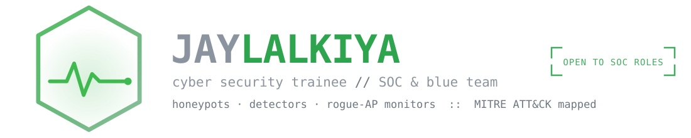

  

  

<pre align="center">
$ whoami
jay_lalkiya — cyber security trainee // builds the attack to find where the detection goes

$ cat status.txt
NSQF L4 @ Adani Saksham · open to SOC analyst / cybersecurity internship roles
</pre>

  
  

---

## ▚ whoami

I'm a final-year **BCA (Honours)** student from **Gujarat**, currently working through a **300+ hour NSQF Level 4 Cyber Security program** at Adani Saksham — covering network foundations, firewalls & access control, audit & compliance, SOC monitoring/escalation, and VAPT fundamentals in controlled lab environments.

My background is in software development (React, Node.js, Java), which turned out to be a real advantage on the security side — I understand how applications are actually built, so I can reason about *why* a vulnerability exists, not just recognize that one does.

- 🎓 BCA (Hons), CGPA **8.48** / **84.09%** — Bhakta Kavi Narsinh Mehta University
- 🔐 In progress: NSQF L4 Cyber Security — networking, firewalls, SOC workflows, VAPT
- 🧠 Interested in: web app security, threat detection, incident response basics
- 🌐 Portfolio: **[jaylalkiyaportfolio.vercel.app](https://jaylalkiyaportfolio.vercel.app/)**
- 💬 Ask me about firewalls & access control, SOC alert triage, or OWASP basics
- 📫 Reach me at **jaylalkiya02@gmail.com** — open to SOC analyst / cybersecurity internship roles

 

  
  
  

---

## ▚ Security skills

**Supporting technical background** (used to understand what I'm defending)

---

## ▚ GitHub stats

  
  

  

---

## ▚ Security projects

Five tools, led with the ones closest to the SOC/blue-team work I'm aiming at.
Each one implements the defensive side *and* the offensive side, because
building the attack is what taught me where the detection has to go.
🟢 detection / blue-team build &nbsp; &nbsp; 🔴 offensive tooling (built to learn the attack)

### 🟢 🍯 GullakTrap — Multi-Protocol Honeypot

Seven decoy services — HTTP, FTP, SSH, Telnet, SMB, SMTP, SNMP — that log every
credential tried and every command run. The SSH sensor serves a fake filesystem
and records inter-keystroke timing, so a session replays at the speed it was
typed. Each event is scored and mapped to an ATT&CK technique, and a bundled
red-team simulator speaks all seven protocols so the detection chain can be
proven end to end.

 

### 🟢 📡 Wifi-Sentry — Rogue Access Point Monitor

Detects evil-twin access points without monitor mode or Npcap, by reading the
beacon metadata Windows already collects. An attacker can clone an SSID in five
seconds, but not the BSSID behind it — so the tool baselines the real radios and
alerts on a name broadcast from a MAC that was never there. Passive only: never
transmits, never deauthenticates, never captures traffic.

 

### 🔴 🌩️ ScopeStorm — Authorized Load & Resilience Console

Generates controlled HTTP load — but refuses to fire until a Rules-of-Engagement
file authorizes the exact target, the concurrency / RPS ceilings, and the time
window, and it aborts itself the moment error rate or p95 latency crosses the
configured thresholds. Every run is written to a tamper-evident, hash-chained
audit log that verifies on read, so any later edit or deletion breaks the chain
and the whole engagement can be proven after the fact. The project was really
about the guardrails: building a load tool that physically can't be pointed
somewhere it wasn't cleared for.

 

### 🔴 🦅 ReconRaptor — Chained Web Recon Pipeline

Chains the standard web-recon tools — nmap, whatweb, gobuster/feroxbuster,
nikto, nuclei, subfinder/httpx — into a single authorized run, writes every
step to a per-target folder, and rolls the results into a severity-ranked
HTML + JSON report, from the CLI or a dark Tkinter console. Per-step timeouts,
graceful skipping of missing tools, resumable runs, and *structured* output
(nmap XML, nikto JSON, nuclei JSONL) so the report is parsed from machine data
rather than screen-scraped. The point of chaining it was to see exactly how
much noise a full recon sweep drops into a defender's logs — which is where the
detection work starts. Runs only against targets you're authorized to test.

 

### 🟢 🖼️ StegoVault — Steganography & Steganalysis

Hides an encrypted message in the low bit of a PNG, then detects it. The
passphrase goes through PBKDF2 at 200,000 iterations; a wrong key or a single
flipped bit is refused rather than silently mangled. The detector implements RS
Analysis (Fridrich, Goljan & Du, 2001) and scores any image 0–100 — including
images produced by other tools, which is how I know it isn't just recognising
its own output.

---

## ▚ Development background

Before security I built applications, which is why I can reason about *why* a
vulnerability exists rather than only spotting that one does.

**[CodeShelf](https://github.com/jaylalkiya/CodeShelf)**

· multi-module web app built with authentication and role-based access
control as first-class concerns: session management, MVC structure, and a schema
designed around least privilege.

---

## ▚ Experience & training

**Cyber Security Program, NSQF Level 4** — Adani Saksham, Ahmedabad · *2026 – Present*
300+ hours covering network foundations, firewalls and access control, audit & compliance, SOC monitoring and escalation, and VAPT in controlled environments.

**React.js and Node.js Developer Intern** — TechRover Solutions · *Dec 2025 – Jan 2026*
120 hours building a full application (auth, REST APIs, PostgreSQL schema design). Included here because understanding how apps are built end-to-end directly informs how I think about where they break.

---

## ▚ Say hi

  
  
  
  

 

  <i>"Understand how it's built to understand how it breaks."</i>

