

  

  
  
  

  <a href="#whoami"><code>[ whoami ]</code></a>&nbsp;
  <a href="#capabilities"><code>[ capabilities ]</code></a>&nbsp;
  <a href="#internship-codealpha"><code>[ codealpha ]</code></a>&nbsp;
  <a href="#security-projects"><code>[ projects ]</code></a>&nbsp;
  <a href="#attck-coverage"><code>[ att&amp;ck ]</code></a>&nbsp;
  <a href="#experience"><code>[ experience ]</code></a>&nbsp;
  <a href="#contact"><code>[ contact ]</code></a>

<h2 id="whoami">&#9618; whoami</h2>

  

I started as a developer (React, Node.js, Java), so I know how applications are built. That helps me work out *why* a vulnerability exists, not just spot that it does. Now I build the attack to learn where the detection has to go.

<h2 id="capabilities">&#9618; capabilities</h2>

  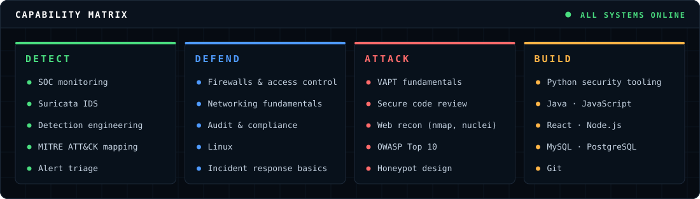

<h2 id="internship-codealpha">&#9618; internship: CodeAlpha</h2>

Four security builds from my CodeAlpha internship (Oct to Nov 2026), each public with source and docs.

  <a href="https://github.com/jaylalkiya/CodeAlpha_NetworkIDS">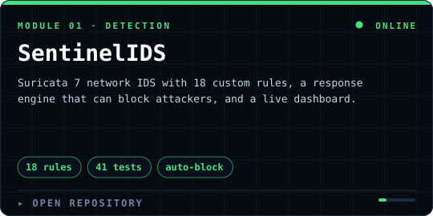</a>
  <a href="https://github.com/jaylalkiya/CodeAlpha_SecureCodingReview">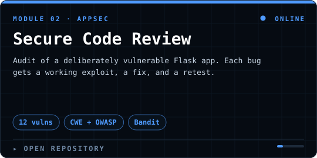</a>
  <a href="https://github.com/jaylalkiya/CodeAlpha_PacketSentry">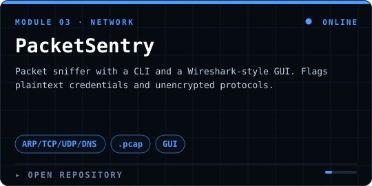</a>
  <a href="https://github.com/jaylalkiya/CodeAlpha_PhishingAwareness">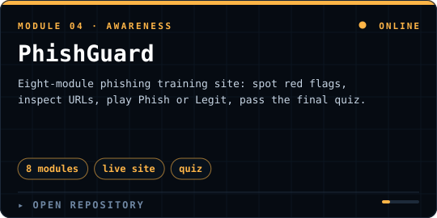</a>

<b>&#9656; Watch SentinelIDS catch a replayed attack</b>

 

  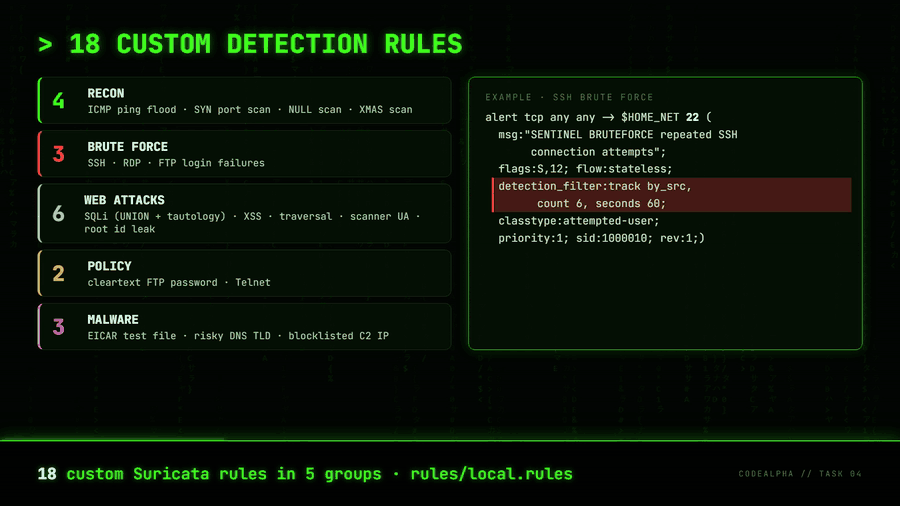

PhishGuard is live: **[try the training site](https://jaylalkiya.github.io/CodeAlpha_PhishingAwareness/)**

<h2 id="security-projects">&#9618; security projects</h2>

<picture>
  <source media="(prefers-color-scheme: dark)" srcset="assets/mode-dark.svg" />
  <source media="(prefers-color-scheme: light)" srcset="assets/mode-light.svg" />
  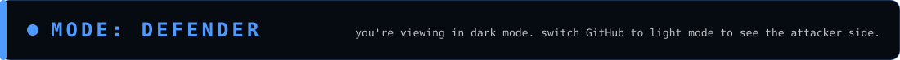
</picture>

Green modules catch attacks. Red modules are attacks I built to learn where detection has to go, and they only run against targets I'm authorized to test.

  <a href="https://github.com/jaylalkiya/gullaktrap">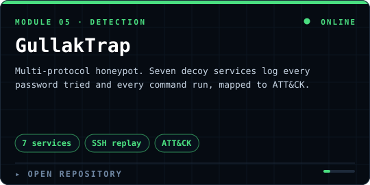</a>
  <a href="https://github.com/jaylalkiya/Wifi-Sentry">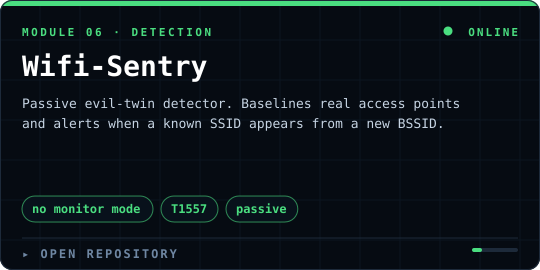</a>
  <a href="https://github.com/jaylalkiya/ScopeStorm">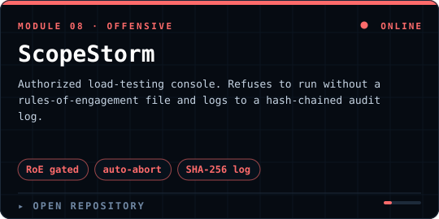</a>
  <a href="https://github.com/jaylalkiya/Recon-Raptor">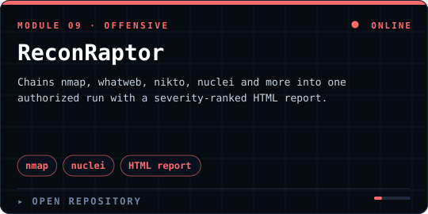</a>
  <a href="https://github.com/jaylalkiya/StegoVault">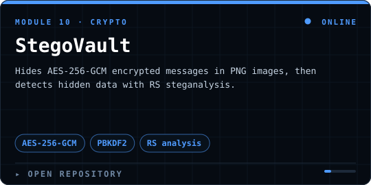</a>

Developer background: <b><a href="https://github.com/jaylalkiya/CodeShelf">CodeShelf</a></b>, a Java/JSP + MySQL web app built with authentication, role-based access control and least-privilege schema design.

<h2 id="attck-coverage">&#9618; att&amp;ck coverage</h2>

  

<h2 id="experience">&#9618; experience</h2>

  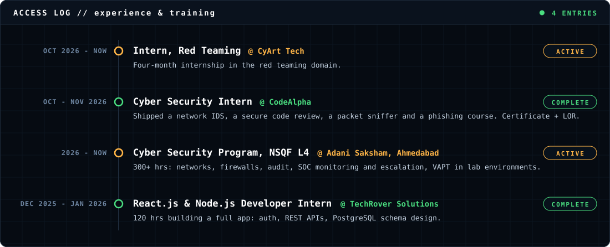

  

<h2 id="contact">&#9618; contact</h2>

  
  
  

  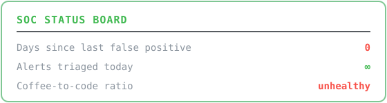

<i>"Understand how it's built to understand how it breaks."</i>

